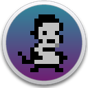
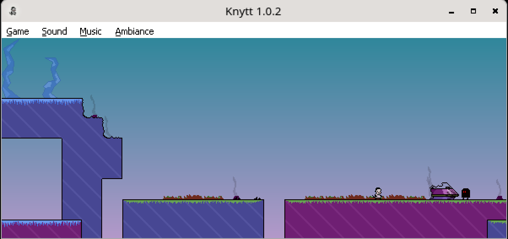
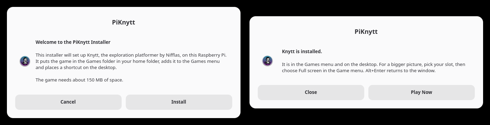

<p align="center"></p>

<h1 align="center">PiKnytt</h1>

<p align="center"><b>Knytt on the Raspberry Pi.</b><br>A friendly installer that sets up Nifflas's 2006 exploration platformer on a Pi 4, 400, 5 or 500, ready to play from the Games menu.</p>

<p align="center"><a href="../../releases/latest"><b>Download for Raspberry Pi OS</b></a></p>



## What it does

Knytt is a free Windows game by Nicklas Nygren, known as Nifflas. A small creature is carried off by an alien, the ship crashes on a strange planet, and the way home is yours to find. PiKnytt installs the game on a Raspberry Pi. The installer adds a small copy of Wine that runs this one game, and puts Knytt in the Games menu and on the desktop.

The whole install is 150 MB in one folder in your home folder.

## The original game

Knytt is the work of Nifflas, who released it as freeware in 2006. His site, nifflas.ni2.se, no longer serves the download, so this repository carries `Knytt.exe` itself. It is the original 1.0.2 release, unmodified. The installer patches the copy it installs so the picture can be scaled.

**The game is back in print as [Knytt Classic](https://store.steampowered.com/app/2656050/Knytt_Classic/).** Nifflas and Bit Kid rebuilt it for its twentieth anniversary, and it is free on Steam for Windows, macOS and Linux PCs. On a PC, play that. PiKnytt exists for the Raspberry Pi, whose ARM processor that version is not built for.

PiKnytt is an unofficial installer and is not affiliated with Nifflas.

## Features

- **A proper installer.** A welcome screen, a progress bar and a finished screen, built from the dialogs Raspberry Pi OS already has. No terminal needed.
- **Nothing else to download.** The game comes with the installer.
- **Small.** A stock Wine install for this game takes 2.4 GB plus a 2.3 GB prefix. This one is trimmed to the files the game opens, 122 MB in all.
- **Self-contained.** Everything lives in `Games/Knytt`. Nothing is installed system-wide and no packages are added.
- **Sharp pixels at any size.** Knytt draws a 600 by 240 picture. The Game menu has 1x, 2x and 3x window sizes, the window can be resized or maximized, and Full screen shows the largest whole multiple that fits the display. Whole multiples repeat each pixel exactly, and sizes in between are drawn with sharp bilinear, which keeps pixels crisp and lines an even width.
- **Ready for the Pi 5 and Pi 500.** Wine needs a kernel with 4K memory pages, and the installer switches the Pi to the one it already has.
- **Reinstall or remove.** Run the installer again. Reinstalling keeps your saved games.



## Install

1. Download `PiKnytt.tar.gz` from the [latest release](../../releases/latest) and extract it. In the file manager, right-click the file and choose Extract Here.
2. Open the `PiKnytt` folder, double-click `install.sh` and choose Execute.
3. Choose **Install**, then **Play Now**.

From a terminal the same thing is:

```bash
tar -xzf PiKnytt.tar.gz && PiKnytt/install.sh
```

| Raspberry Pi | Notes |
| --- | --- |
| Pi 4 and Pi 400 | Installs and runs as it is. |
| Pi 5 and Pi 500 | The installer first switches the Pi to its 4K kernel by adding three lines to `/boot/firmware/config.txt`. Restart, then run the installer again. |

It needs 64-bit Raspberry Pi OS 13 (trixie) or newer with the desktop, and 200 MB of free space.

## Playing

Start Knytt from the Games menu or the desktop. Choose **Instructions** first; it teaches the controls and unlocks the three save slots. The Left and Right arrow keys move, and S jumps.

The Game menu has **Size 1x**, **Size 2x** and **Size 3x** for the window, and the game remembers the one you pick. Dragging the window's edge or maximizing it grows the picture to fit. **Full screen** is in the same menu.

| Key | Action |
| --- | --- |
| Alt+Enter | Enter or leave full screen |
| Ctrl+R | Restart from the last save point |
| Alt+F4 | Quit |

Saved games are kept in `Games/Knytt/game`.

## How it works

Knytt is a 32-bit Windows program. It runs under [Hangover](https://github.com/AndreRH/hangover), a build of Wine for ARM64 that emulates only the game's own x86 code with Box64 and runs everything else natively.

`runtime.tar.xz` holds that Wine, cut down to this game. Hangover ran the game under `strace`, and only the files it opened were kept, with the debug data removed from each DLL. The Wine prefix keeps its registry and folders, and its DLLs are links into the same Wine. The machine that built it leaves no trace in it, so it works for any user in any home folder.

The installed `Knytt.exe` is a patched copy, made by `tools/patch-game.py`. Knytt.exe is an unpacker followed by its runtime files and the game data. The patch sets the game's Stretch flag, so the runtime stretches the picture to its window, and adds `Scale.sft` to the runtime files. The runtime loads every `.sft` file as a sound filter. This one is built from `tools/scale.c` and manages the window instead. It adds the sizes to the Game menu, keeps the picture at 600:240 inside whatever size the window has, and saves the chosen size in `Settings.ini`. At a whole multiple the runtime's own stretch repeats each pixel. At any other size the filter draws the picture itself with sharp bilinear, where each game pixel covers the same span of the screen and only the screen pixels on a boundary blend their two neighbours. Full screen is a borderless window the size of the display, so the display mode never changes.

## Building the runtime

This is only needed for a newer Hangover. It takes a Pi with a 4K kernel and 6 GB free.

```bash
mkdir -p ~/knytt-build/game && cd ~/knytt-build
wget https://github.com/AndreRH/hangover/releases/download/hangover-11.16/hangover_11.16_debian13_trixie_arm64.tar
tar -xf hangover_11.16_debian13_trixie_arm64.tar
mkdir root && for d in hangover-wine*.deb hangover-wowbox64*.deb; do dpkg-deb -x "$d" root; done
```

Copy `Knytt.exe` into `~/knytt-build/game`, create a full prefix, then record what the game opens while you visit the menus, play for a minute and go in and out of full screen:

```bash
export WINEPREFIX=$HOME/knytt-build/prefix-full WINEDLLOVERRIDES="mscoree=d;mshtml=d"
W=$HOME/knytt-build/root/usr/bin
$W/wine wineboot --init
$W/wineserver -k
cd ~/knytt-build/game
strace -f -y -qq -e trace=openat,open,execve -o ~/knytt-build/trace1.log $W/wine Knytt.exe
```

`tools/build-runtime.sh` then trims Hangover to the traced files, and `tools/pack-runtime.sh ~/knytt-build/runtime` writes `runtime.tar.xz`. `Scale.sft` is rebuilt with `tools/build-scale.sh`, which needs [zig](https://ziglang.org) and runs on any machine.

A release is the installer, the runtime, the game, the filter, the patch script, the icon and the licence in one archive:

```bash
git archive --format=tar.gz --prefix=PiKnytt/ -o PiKnytt.tar.gz HEAD install.sh runtime.tar.xz Knytt.exe Scale.sft tools/patch-game.py icon.png LICENSE
```

## AI use disclosure

PiKnytt was built using [Claude Code](https://claude.com/claude-code) with Claude Fable 5.2.

## Credits

Knytt was made by Nicklas Nygren (Nifflas). The full credits are on the game's title screen. The icon is the game's own, set on a sky taken from the game.

The runtime is built from [Hangover](https://github.com/AndreRH/hangover) 11.16 by André Zwing and contributors, which combines [Wine](https://www.winehq.org) (LGPL 2.1 or later) with [Box64](https://github.com/ptitSeb/box64) by ptitSeb (MIT). Source for those binaries is at the Hangover 11.16 tag.

## Licence

The installer, `Scale.sft` and the build scripts are free software under the [MIT licence](LICENSE). `Knytt.exe` is not covered by it. The game remains the copyright of Nicklas Nygren and is included as the freeware release he published. The Wine and Box64 binaries in `runtime.tar.xz` keep their own licences, named above.
